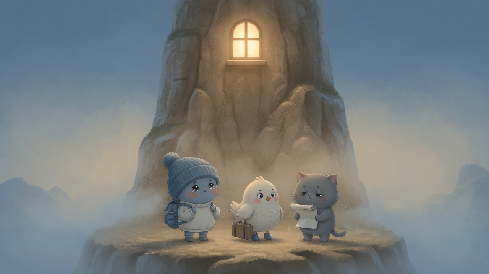
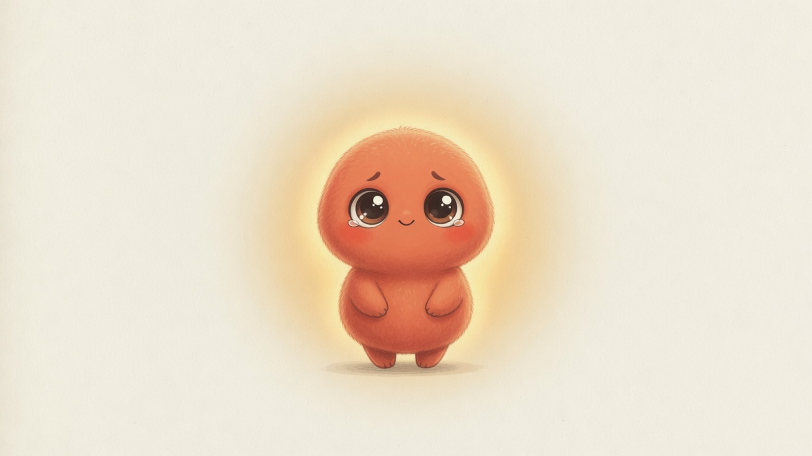
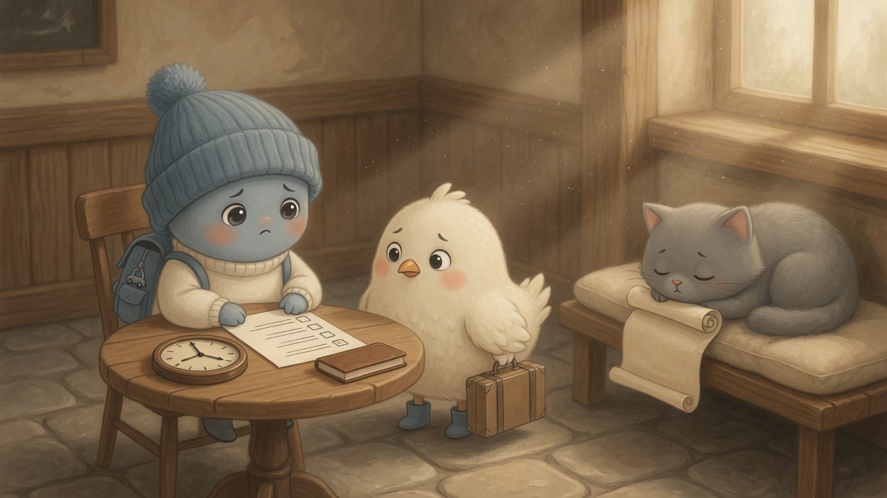
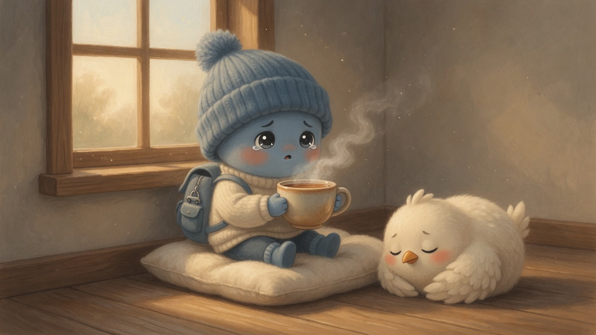
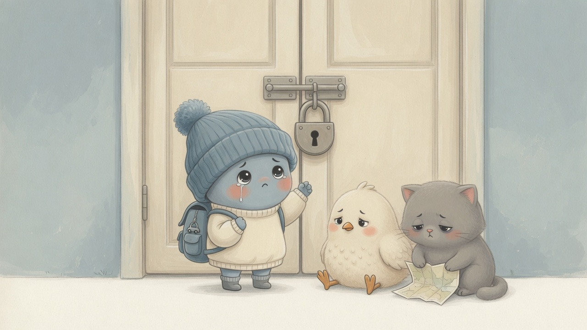
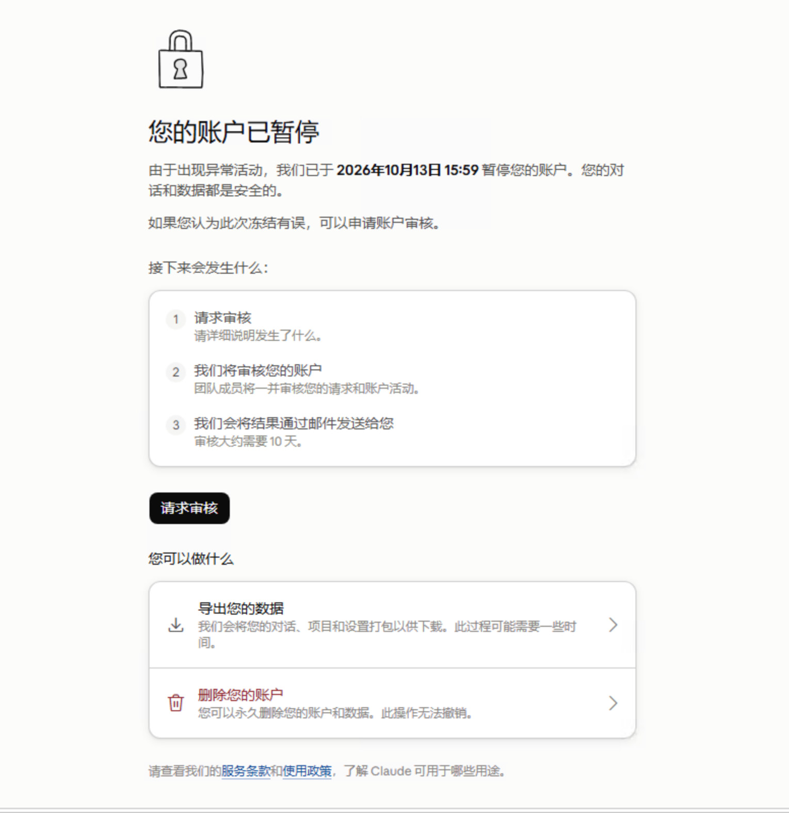

# climb2claude

小爬想上楼。楼上有一扇亮着的窗。路很远，小爬又小，背包比人还沉。

同行的还有一只拎箱子的小鸡，和一只总抱着纸条的小猫。

楼上住着一只橙色的。它也不大，站着的时候会轻轻发光。小爬要去见的就是它。

## 环境

小爬先在店里把清单对了一遍。钟拨到美国，书换成英语。小鸡负责把路接到外面，小猫负责把纸条吃进去。三个人都有点紧张，但谁也没抱怨。

细节在这些笔记里：

- [体检、通道、时区和上车](docs/01-check-network.md)
- [体检站](docs/net-coffee.md)
- [选鸡](docs/digvps.md)
- [客户端](docs/clients.md)

## 养号

窗边坐下来，捧着杯子，小声说话。先别干活。小鸡在旁边睡着了。

[怎么聊，写在这里。](docs/02-warmup.md)

## 充值

存钱罐还关着。小爬看了看，又把盖子盖好。

[这一段还没写。](docs/03-topup.md)

## 保养

药箱也还没打开。

[这一段还没写。](docs/04-upkeep.md)

## 门锁上了

2026 年 10 月 13 日，门上了锁。小爬敲了敲。里面说对话和数据都还在，可以申请审核，大概要十天。

## 许可

[MIT](LICENSE)
