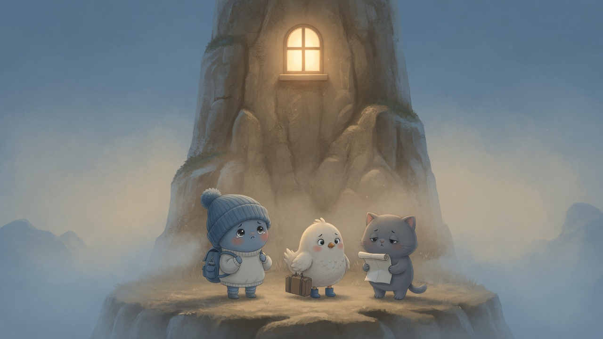
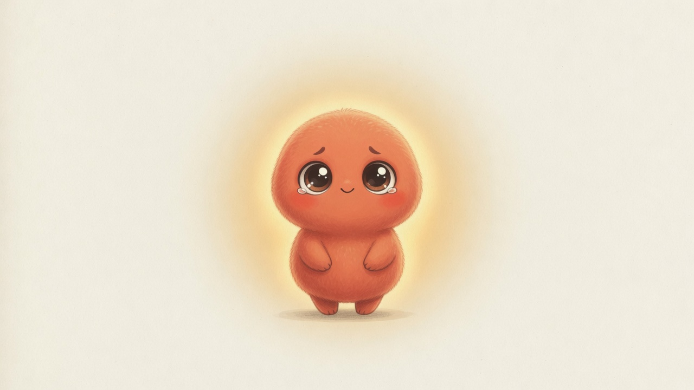
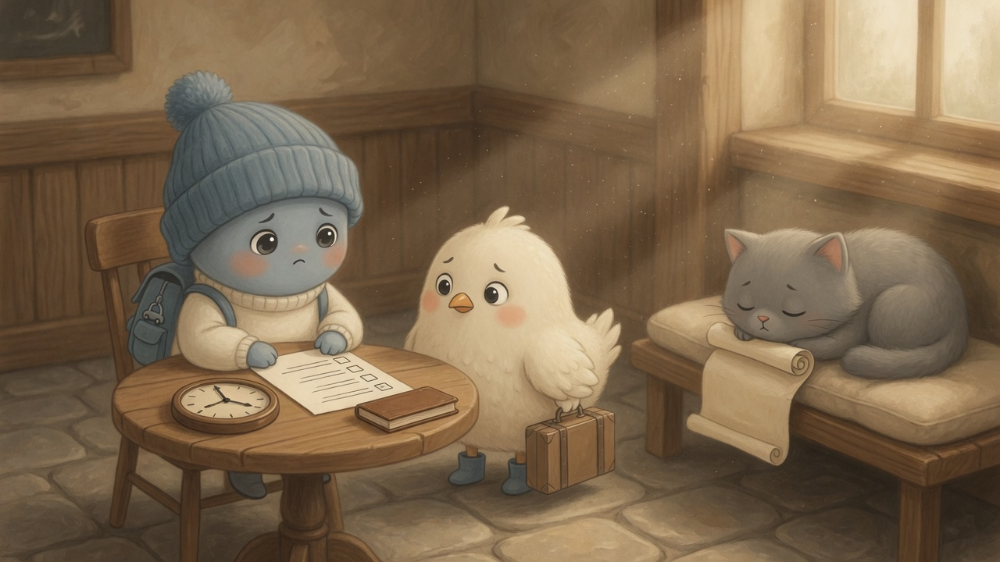
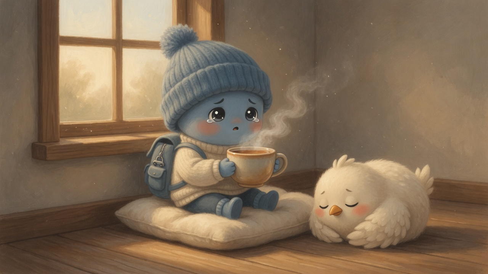
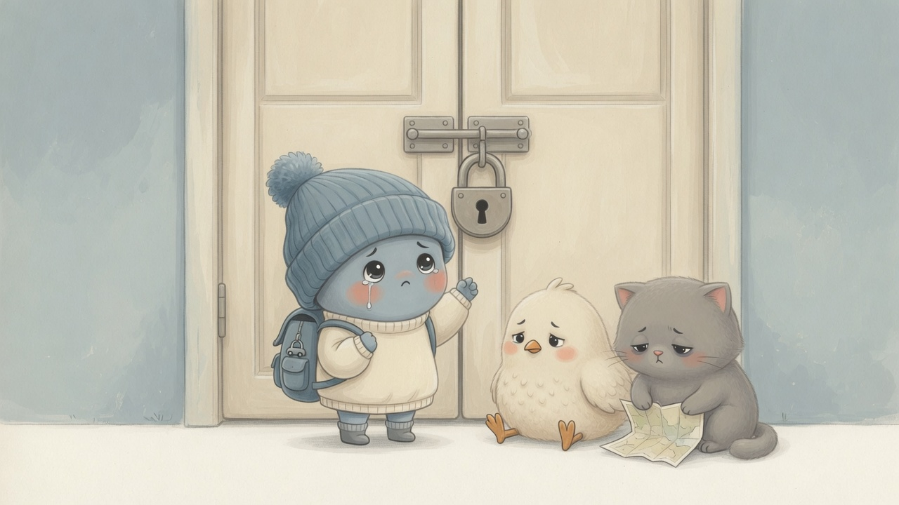
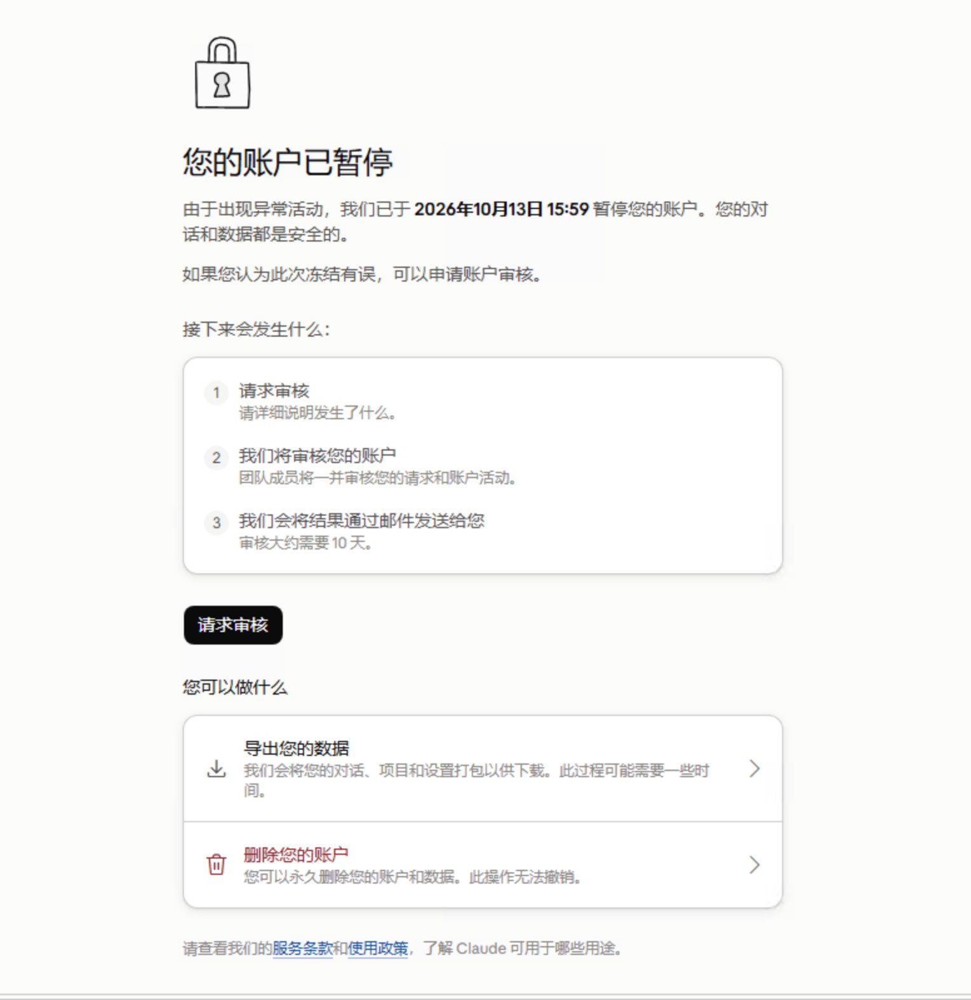
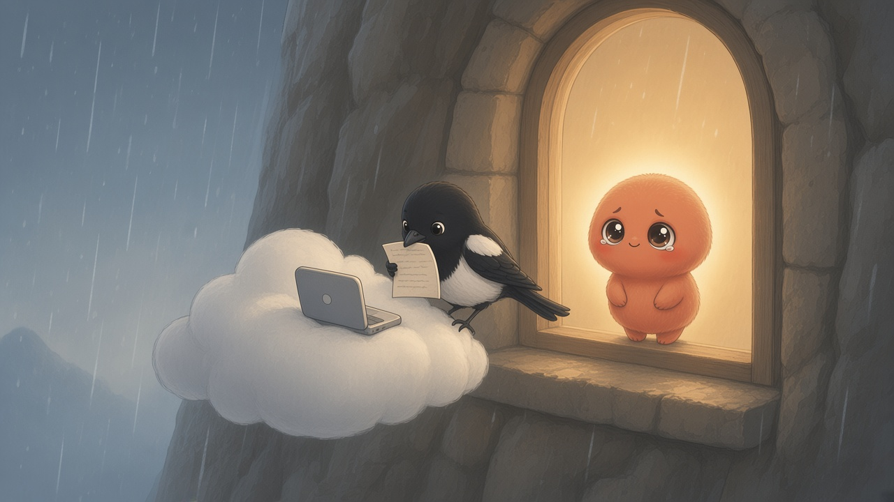
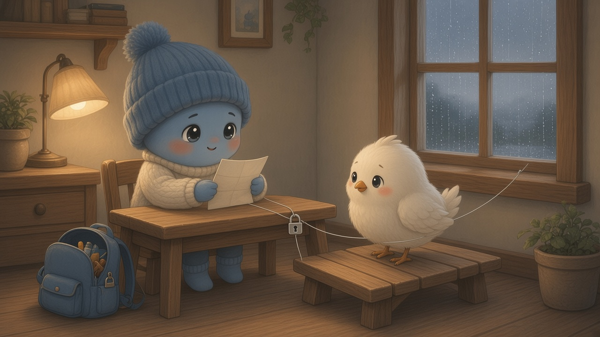

# climb2claude

小爬想上楼。楼上有一扇亮着的窗。路很远，小爬又小，背包比人还沉。

同行的还有一只拎箱子的小鸡，和一只总抱着纸条的小猫。

楼上住着一只橙色的。它也不大，站着的时候会轻轻发光。小爬要去见的就是它。

## 环境

上楼之前，先把脚下的路铺好。小爬在店里把清单对了一遍。钟拨到美国，书换成英语。小鸡负责把路接到外面，小猫负责把纸条吃进去。三个人都有点紧张，但谁也没抱怨。

清单记在这些笔记里：

- [体检、通道、时区和上车](docs/01-check-network.md)
- [体检站](docs/net-coffee.md)
- [选鸡](docs/digvps.md)
- [客户端](docs/clients.md)

## 养号

路通了，先别干活。窗边坐下来，捧着杯子，小声说话，把日子过成普通人的样子。小鸡在旁边睡着了。

[怎么聊，写在这里。](docs/02-warmup.md)

杯子见了底，下一步本该往存钱罐里放硬币，再把这间屋子维持住。罐盖还盖着，药箱也还没打开。这两页先空在这儿。

- [充值](docs/03-topup.md)
- [保养](docs/04-upkeep.md)

## 门锁上了

还没走到那两页，门先上了锁。2026 年 10 月 13 日，三个人都停在门前。小爬敲了敲。里面说对话和数据都还在，可以申请审核，大概要十天。

橙色的那只仍在门后。崖上的楼梯，暂时停在这里。

## 海那边的窗

后来，英伦的雨里亮起了另一扇窗。窗边放着一台住惯了云端的小本子，它已经和橙色那只打过招呼。一只喜鹊守在窗台，替两边收纸条。

小爬坐回自己的桌前。背包敞在手边，沉东西都留在家里。一根上锁的细线从桌边牵出去。小鸡在半路搭了座桥，把家里这一头和海那边那一头接上。

纸条递出去，橙色的回答就沿着细线回来。终于能接着干活了。

[这条路怎么接，记在这里。](docs/claude-ssh.md)

## 许可

[MIT](LICENSE)
