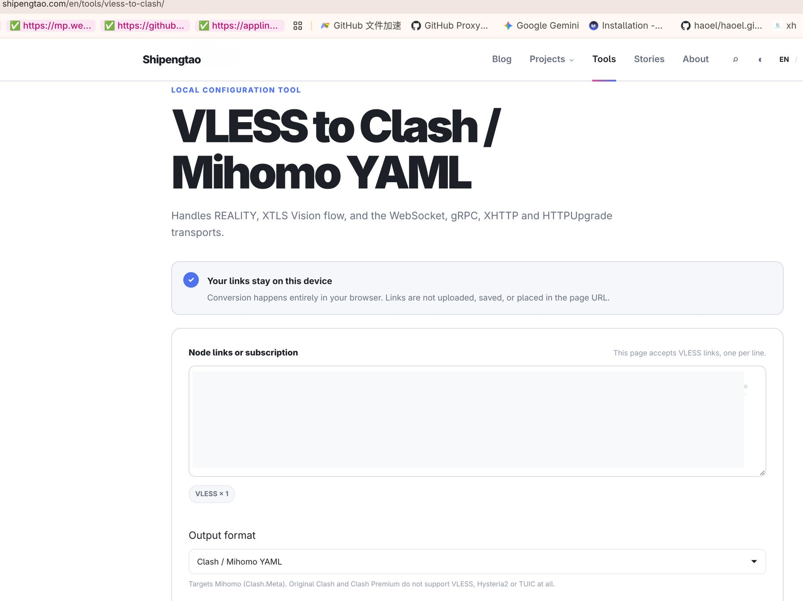
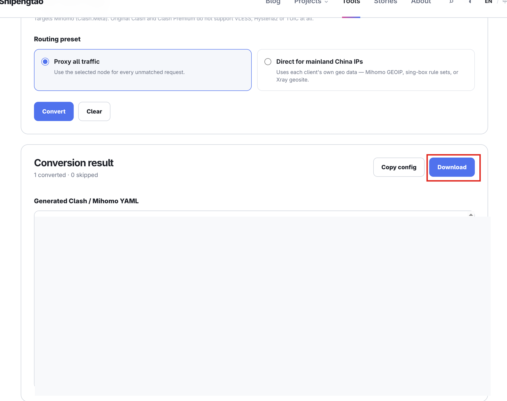

# 第一步：先体检

日期：2026-10-20

打开 [咖啡店那页体检](https://ip.net.coffee/claude/)，红字和黄条清掉再谈上车。体检在浏览器里做，DNS 和 WebRTC 都算。命令行打开同一个网址，看不到这两项。

家门地址和 DNS 落点不要写进仓库。

## 合格线

| 项目 | 过关 |
| --- | --- |
| 页顶 | 没有「当前为 IPv6 环境」 |
| Claude 落地 | IPv4，并且和 Cloudflare 那张卡片是同一次落地 |
| 信任分 | 「纯净」，支持地区为「正常」 |
| DNS | 不是「可能泄露」，没有「中国DNS」 |
| WebRTC UDP | 不是「可能泄露」，归属地不是 China，出口没有「异常」 |
| 可用性 | `claude.ai`、`anthropic.com` 为「正常」，服务状态正常 |

信任分过 75 且标成纯净，这只小鸡就先留着。机房不如家宽，分已经够纯净时，这一步不换鸡。

## 这一次的结果

体检页同时甩出三张落地卡片：家门 IPv4、一条美国 Cloudflare IPv4、一条美国 Claude IPv6。Claude 那张被标成机房。

已经过关：

- 信任分 82，纯净，支持地区正常
- 页面未点出 VPN、代理、Tor 和滥用记录
- `claude.ai` 与 `anthropic.com` 正常，约 186ms，服务全部正常

还没过关：

- 页顶说现在是 IPv6，Claude 落地也是 IPv6
- 家门 IPv4 还在，和两条境外落地同时出现
- DNS 为「可能泄露」，徽章是「中国DNS」，服务商是中国电信
- WebRTC UDP 为「可能泄露」，出口标成异常，归属地是 China

## 原因

本机客户端是 Clash Verge Rev，内核是 mihomo。当时的开关是：

- 系统开关开着，模式是 `rule`
- 虚拟网卡关着
- 客户端的 `ipv6` 为 `true`，系统侧也没关 IPv6
- 客户端自己的 DNS 开着，系统解析器没走它

系统开关只带走浏览器的 HTTP 和 HTTPS。所以 Claude 和 Cloudflare 的体检走到了美国，DNS 和 WebRTC 的 UDP 仍从家门出去。体检页看到的 DNS 服务商是中国电信；系统当时走的加密 DNS 是 AliDNS。漏风的那一路查询没有走这条加密 DNS。

客户端允许 IPv6 之后，Claude 落地走了小鸡的 IPv6，Cloudflare 仍是另一条 IPv4。页顶因此亮起 IPv6 黄条。

## 解决办法

换一只干净的境外小鸡当地落。鸡上用 [233boy/sing-box](https://github.com/233boy/sing-box) 的[一键脚本](https://233boy.com/sing-box/sing-box-script/)把通道支起来，拿走分享串，再经 [转换页](https://shipengtao.com/en/tools/vless-to-clash/) 落成小猫能吃的粮单，喂给本机的 Clash Verge Rev。

分享串、UUID 和粮单只留在本机，不进仓库。

### 1. 找小鸡

准备一只境外小鸡。脚本认 Ubuntu、Debian、CentOS，作者更认 Ubuntu 22。装好后用 root 登上去。

云厂商那边的口子要给节点端口留门。装完之前端口还不知道，装完按脚本给出的端口补。

### 2. 把通道支起来

下面这条在小鸡上跑，不在本机跑。脚本出自上面的仓库，装完会自己生出一条 VLESS-REALITY：

```bash
bash <(wget -qO- -o- https://github.com/233boy/sing-box/raw/main/install.sh)
```

装完在小鸡上用 `sb` 进面板。看分享串：

```bash
sb url
```

默认只有一条时，会打出整行 `vless://...`。整行复制走。

口子不通时，用 `sb ip` 看小鸡地址，再打开 [tcp.ping.pe](https://tcp.ping.pe/)，填 `IP:端口`。看到 successful 再往下。脚本和配置在小鸡上的 `/etc/sing-box`。

### 3. 落成粮单

本机浏览器打开 [转换页](https://shipengtao.com/en/tools/vless-to-clash/)。转换在浏览器里完成，分享串不会上传。

1. 分享串贴进输入框，一行一条。页面标出 **VLESS × 1** 就可以。
2. 输出选 **Clash / Mihomo YAML**。本机内核是 mihomo；原版 Clash 和 Clash Premium 吃不下这种分享串。



3. 路由选 **Proxy all traffic**，体检流量走这只小鸡。
4. 点 Convert。结果是 `1 converted · 0 skipped` 时，再点 Download，把粮单存下来。



图里的分享串和粮单正文已抹掉，只留页面上的选项。

这张粮单是一次性的，不会自己更新。小鸡上的 UUID、端口或密钥变过之后，重新 `sb url`，再转一次。

### 4. 喂给小猫

在 Clash Verge Rev 里：配置 → 新建 → 本地配置，选中刚落下的粮单。启用它，并选中里面那只小鸡。

做过体检的浏览器完全关掉再开。旧页面会留着上一次的 WebRTC。

## 复测

刷新 [体检页](https://ip.net.coffee/claude/)，按上面的合格线再看一遍。Claude 落地应换成这只小鸡的 IPv4。六项都过，这一步才算完。

DNS 或 WebRTC 若仍指向家门，把虚拟网卡打开，让 UDP 和 53 端口也进这份粮单，然后再测一次。

## 撤回

在 Clash Verge Rev 里停用这份本地粮单，切回原来的配置。

小鸡上拆掉脚本：

```bash
sb uninstall
```

`sb del` 会直接拆掉节点，而且不再问一声。只是想停用的话，在客户端切走就行。
