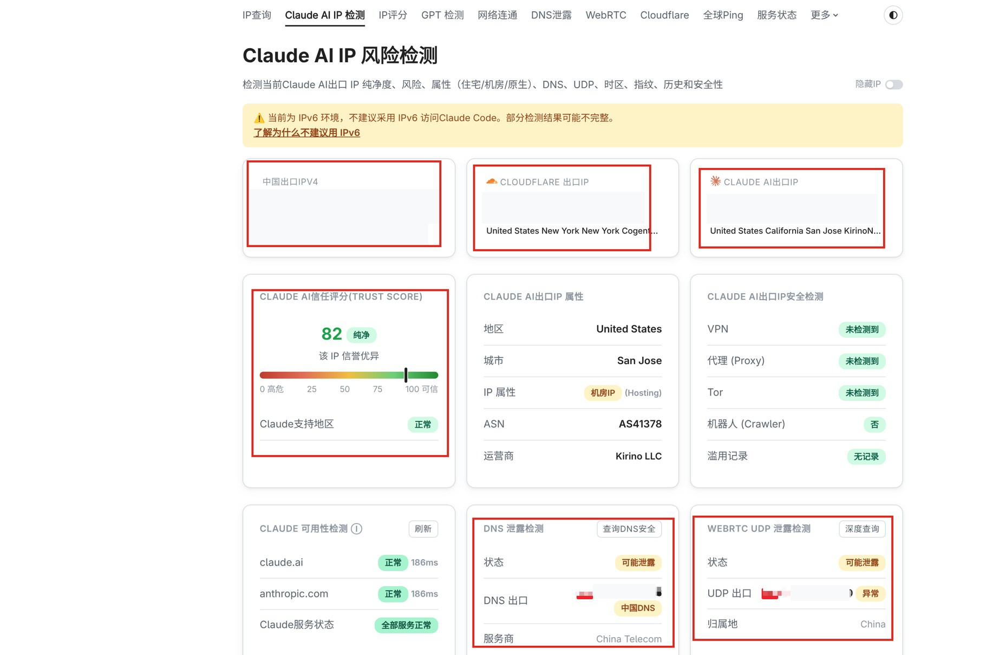

# 环境

日期：2026-10-20

打开 [咖啡店那页体检](https://ip.net.coffee/claude/)，红字和黄条清掉再谈上车。这个站的其他页收在 [体检站](net-coffee.md)。体检在浏览器里做，DNS 和 WebRTC 都算。命令行打开同一个网址，看不到这两项。

家门地址和 DNS 落点不要写进仓库。

## 合格线

| 项目 | 过关 |
| --- | --- |
| 页顶 | 没有「当前为 IPv6 环境」 |
| Claude 落地 | IPv4，并且和 Cloudflare 那张卡片是同一次落地 |
| 信任分 | 「纯净」，支持地区为「正常」 |
| DNS | 不是「可能泄露」，没有「中国DNS」 |
| WebRTC UDP | 不是「可能泄露」，归属地不是 China，出口没有「异常」 |
| 可用性 | `claude.ai`、`anthropic.com` 为「正常」，服务状态正常 |
| 时区 | `America/Los_Angeles`；落地在东岸时用 `America/New_York` |
| 语言 | 系统语言和浏览器第一语言都是英语 |

信任分过 75 且标成纯净，这只小鸡就先留着。机房不如家宽，分已经够纯净时，这一步不换鸡。

## 这一次的结果



体检页同时甩出三张落地卡片：家门 IPv4、一条美国 Cloudflare IPv4、一条美国 Claude IPv6。Claude 那张被标成机房。图里的地址已抹掉。

已经过关：

- 信任分 82，纯净，支持地区正常
- 页面未点出 VPN、代理、Tor 和滥用记录
- `claude.ai` 与 `anthropic.com` 正常，约 186ms，服务全部正常

这次还没过关：

- 页顶说现在是 IPv6，Claude 落地也是 IPv6
- 家门 IPv4 还在，和两条境外落地同时出现
- DNS 为「可能泄露」，徽章是「中国DNS」，服务商是中国电信
- WebRTC UDP 为「可能泄露」，出口标成异常，归属地是 China

后来打开虚拟网卡，WebRTC 这一项过了。上面三条当时没一起复测。

## 原因

本机客户端是 Clash Verge Rev，内核是 mihomo。当时的开关是：

- 系统开关开着，模式是 `rule`
- 虚拟网卡关着
- 客户端的 `ipv6` 为 `true`，系统侧也没关 IPv6
- 客户端自己的 DNS 开着，系统解析器没走它

系统开关只带走浏览器的 HTTP 和 HTTPS。所以 Claude 和 Cloudflare 的体检走到了美国，DNS 和 WebRTC 的 UDP 仍从家门出去。体检页看到的 DNS 服务商是中国电信；系统当时走的加密 DNS 是 AliDNS。漏风的那一路查询没有走这条加密 DNS。

客户端允许 IPv6 之后，Claude 落地走了小鸡的 IPv6，Cloudflare 仍是另一条 IPv4。页顶因此亮起 IPv6 黄条。

## 解决办法

换一只干净的境外小鸡当地落。鸡上用 [233boy/sing-box](https://github.com/233boy/sing-box) 的[一键脚本](https://233boy.com/sing-box/sing-box-script/)把通道支起来，拿走分享串或订阅，再用仓库里的 `tools/sub2clash.py` 在本机落成小猫能吃的粮单，喂给本机的 Clash Verge Rev。

分享串、UUID 和粮单只留在本机，不进仓库。

### 1. 找小鸡

准备一只境外小鸡。先到 [选鸡](digvps.md) 看线路再买。脚本认 Ubuntu、Debian、CentOS，作者更认 Ubuntu 22。装好后用 root 登上去。

云厂商那边的口子要给节点端口留门。装完之前端口还不知道，装完按脚本给出的端口补。

### 2. 把通道支起来

下面这条在小鸡上跑，不在本机跑。脚本出自上面的仓库，装完会自己生出一条 VLESS-REALITY：

```bash
bash <(wget -qO- -o- https://github.com/233boy/sing-box/raw/main/install.sh)
```

装完在小鸡上用 `sb` 进面板。看分享串：

```bash
sb url
```

默认只有一条时，会打出整行 `vless://...`。整行复制走。

口子不通时，用 `sb ip` 看小鸡地址，再打开 [tcp.ping.pe](https://tcp.ping.pe/)，填 `IP:端口`。看到 successful 再往下。脚本和配置在小鸡上的 `/etc/sing-box`。

### 3. 落成粮单

分享串和订阅正文留在本机。用仓库里的 `tools/sub2clash.py` 转成 Clash / Mihomo 粮单，不把内容交给网上的转换页。本机内核是 mihomo；原版 Clash 和 Clash Premium 吃不下这种分享串。

在终端里直接跑，会一条一条问分享串，问完再问要生成的文件名。直接回车结束输入。文件名空着时写成 `clash.yaml`：

```bash
python3 tools/sub2clash.py
```

已经存成文件时，不需要网络，一条命令完成。一行一条分享串，也可以是订阅接口返回的 Base64：

```bash
python3 tools/sub2clash.py links.txt -o clash.yaml
```

`sb url` 打出来的整段也可以直接存进 `links.txt`，工具会从里面拣出分享串。

订阅地址还在网上时，只把正文拉下来，转换仍在本机：

```bash
python3 tools/sub2clash.py --url '订阅地址' -o clash.yaml
```

终端打出 `1 converted, 0 skipped` 就可以。粮单默认把全部流量交给这只小鸡，并写上 `ipv6: false`。节点带 `udp: true`。

交互式在写文件名前会问要不要在线获取最新的中国大陆规则。选是的话，从 [Loyalsoldier/clash-rules](https://github.com/Loyalsoldier/clash-rules) 的最新发布拉下大陆域名和大陆 IP 段，写进同一个粮单。局域网、大陆域名和大陆 IP 直连，其余走代理。一步式加上 `--cn`：

```bash
python3 tools/sub2clash.py links.txt -o clash.yaml --cn
```

只导入这一个文件。不选的话，粮单仍是全部走代理。

这张粮单是一次性的，不会自己更新。小鸡上的 UUID、端口或密钥变过之后，重新拿分享串或订阅，再转一次。

### 4. 喂给客户端

客户端收在 [客户端](clients.md)。本机用的是小猫（Clash Verge Rev）。

在 Clash Verge Rev 里：配置 → 新建 → 本地配置，选中刚落下的粮单。启用它，并选中里面那只小鸡。手机可以用 FlClash，同样导入这份粮单。

做过体检的浏览器完全关掉再开。旧页面会留着上一次的 WebRTC。

## 时区和语言

体检页读的是本机时区名。用美国时区，语言用英语。西岸 `America/Los_Angeles`，落地在东岸就换成 `America/New_York`。钟面会和北京时间差一截。

Chrome、Edge、Firefox 都在设置里的「语言」，把 English 放到第一位。

改完刷新体检页。

### Linux

```bash
timedatectl set-timezone America/Los_Angeles
localectl set-locale LANG=en_US.UTF-8
```

东岸把时区换成 `America/New_York`。撤回时区用 `Asia/Shanghai`，语言用原来的 `LANG`。

### macOS

系统设置 → 通用 → 日期与时间，关掉自动时区，选洛杉矶或纽约。语言与地区里把英语放第一。

```bash
sudo systemsetup -settimezone America/Los_Angeles
```

### Windows

设置 → 时间和语言 → 日期和时间，关掉自动设置时区，选太平洋时间或东部时间。语言里把 English 放第一。

```powershell
Set-TimeZone -Id "Pacific Standard Time"
```

东岸的名字是 `Eastern Standard Time`。

## 复测

刷新 [体检页](https://ip.net.coffee/claude/)，按上面的合格线再看一遍。Claude 落地应换成这只小鸡的 IPv4。六项都过，这一步才算完。

## WebRTC 的 UDP

体检页上的 UDP 出口若还是家门、归属地 China、旁边写着异常，是因为系统开关只带走网页的 HTTPS。浏览器查 WebRTC 时走 UDP，这条没进通道，就从家门直接出去了。

本机已核对：Clash Verge Rev 打开虚拟网卡后，这一项过了。粮单里节点保持 `udp: true`。系统开关可以留着。打开时若要装服务，按提示授权。

改完完全退出做过体检的浏览器，再打开，重新点「深度查询」。过关的样子是 UDP 出口离开家门，归属地离开 China。

虚拟网卡打开后若仍是家门，到 Tun 设置里打开严格路由，再测一次。UDP 出口变成空白，多半是小鸡没转发 UDP，回小鸡用 `sb` 看这条配置。

## 撤回

在 Clash Verge Rev 里停用这份本地粮单，切回原来的配置。虚拟网卡也在首页关掉。

小鸡上拆掉脚本：

```bash
sb uninstall
```

`sb del` 会直接拆掉节点，而且不再问一声。只是想停用的话，在客户端切走就行。

## 上车

体检过了再装。下载和登录按 [官方说明](https://docs.anthropic.com/en/docs/claude-code/setup) 走一遍即可。在这套环境里打开，按提示登录。浏览器登录也走这只小鸡，时区和语言保持上面的设置。

然后看 [养号](02-warmup.md)。
